# Debugging Report: Task Manager with React Developer Tools

This report records how I debugged a small React app with **React Developer Tools**. For each problem it covers the symptom, what DevTools showed, the root cause, the fix and how I checked it.

- Original app with the bugs: [`buggy-version/src`](buggy-version/src). Run it with `npm run dev:buggy`.
- Fixed app: [`src`](src). Run it with `npm run dev`. Every fix in the code is marked `FIX #n`, matching the numbers below.

---

## 1. The sample application

A task manager with six components. `App` owns the state and passes data down as props:

```
App                      state: tasks[], filter
├── Header               props: count
├── AddTaskForm          props: onAdd            state: title
├── FilterBar            props: filter, onChange
├── TaskList             props: tasks, onToggle, onDelete
│   └── TaskItem (×n)    props: task, onToggle, onDelete
└── Stats                props: tasks
```

## 2. Installing React Developer Tools

| Browser | How |
|---|---|
| Chrome / Brave / Edge | Install **React Developer Tools** from the Chrome Web Store (Edge also has it in the Edge Add-ons store) |
| Firefox | Install **React Developer Tools** from Firefox Add-ons |
| Any other environment (Safari, React Native, embedded webviews) | Standalone app: `npx react-devtools`, then add `<script src="http://localhost:8097"></script>` to `index.html` |

After installing, open the app (`npm run dev:buggy`), open the browser DevTools (F12) and you'll see two new tabs: **⚛ Components** and **⚛ Profiler**.

Useful settings (⚙ icon in the Components tab):
- **Highlight updates when components render.** It flashes every component that re-renders, which makes it easy to spot updates that didn't happen.
- **Show inline warnings and errors.**

## 3. First look at the component tree

Opening **⚛ Components** on the buggy app shows this tree. Selecting each component shows its props and hooks on the right:

```
App            hooks: State = [ {id:1, done:true}, {id:2, done:true}, {id:3, done:true} ], State = "all"
  Header         props: taskCount = 3                     ← Header reads `count`
  AddTaskForm    props: onAdd = ƒ        hooks: State = ""
  FilterBar      props: filter = "all", onChange = ƒ
  TaskList       props: tasks = [...], onToggleTask = ƒ, onDelete = ƒ
    TaskItem       props: task = {id:1, done:true}, onToggle = undefined, onDelete = ƒ   ← undefined!
    TaskItem       props: task = {id:2, done:true}, onToggle = undefined, onDelete = ƒ
    TaskItem       props: task = {id:3, done:true}, onToggle = undefined, onDelete = ƒ
  Stats          props: tasks = [...all done: true]       ← nobody clicked anything yet
```



*Left: original. Right: fixed. On first load the original already shows "You have tasks" with no number, "Completed 3 / 3" while only one box is ticked, and a tab title of "0 tasks left".*

## 4. Issues found and fixed

| # | Issue | Type | Component |
|---|---|---|---|
| 1 | Adding a task does nothing | State mutated instead of replaced | `App` |
| 2 | Header says "You have tasks" with no number | Wrong prop name | `App` → `Header` |
| 3 | Ticking a checkbox throws `onToggle is not a function` | Missing prop | `App` → `TaskList` → `TaskItem` |
| 4 | Stats say every task is completed | Assignment instead of comparison, which mutates state | `Stats` |
| 5 | Choosing a filter empties the list | Event object stored in state instead of a string | `FilterBar` |
| 6 | Browser tab title never updates | Missing `useEffect` dependency | `App` |

---

### Issue 1: Adding a task does nothing

**Symptom:** typing "Write the debugging report" and clicking **Add** clears the input, but no new task appears and the header and stats don't change.

**Investigation in DevTools:**
1. With **Highlight updates** on, clicking **Add** flashes only `AddTaskForm` (it re-rendered to clear its input). `App`, `TaskList` and `Stats` don't flash, so they never re-rendered.
2. Selecting `App` shows that the first **State** hook already contains **4** tasks, including the new one, while the page still shows 3.
3. The **⚛ Profiler** confirms it: record, click Add, stop. Only `AddTaskForm` appears in the commit.

So the data changed but React was never told. That's the classic sign of **mutating state**.

**Root cause:** `addTask` changed the existing array with `push` and passed the *same* array back to `setTasks`. React compares state by reference (`Object.is`), sees the same array, and skips the re-render.

```jsx
// Before
const addTask = (title) => {
  tasks.push({ id: Date.now(), title, done: false });
  setTasks(tasks);
};

// After (FIX #1)
const addTask = (title) => {
  setTasks((prev) => [...prev, { id: Date.now(), title, done: false }]);
};
```

I also switched `toggleTask` and `deleteTask` to the functional updater `setTasks(prev => …)` so they always work on the latest state.

**Verified:** the new task appears at once, the header shows 4, and the stats show 1 / 4.

---

### Issue 2: Header shows "You have tasks" with no number

**Symptom:** the count is missing from the subtitle.

**Investigation in DevTools:** selecting `Header` shows its props as **`taskCount: 3`**. Clicking the `<>` (view source) button opens `Header.jsx`, which destructures **`{ count }`**. The parent sends `taskCount`, the child reads `count`, so `count` is `undefined` and renders as nothing.

**Root cause:** the prop name doesn't match between parent and child.

```jsx
// Before
<Header taskCount={tasks.length} />

// After (FIX #2)
<Header count={tasks.length} />
```

**Verified:** `Header` props now show `count: 3`, and the page says "You have 3 tasks".

---

### Issue 3: Ticking a checkbox crashes with `onToggle is not a function`

**Symptom:** clicking a checkbox does nothing and the console shows `TypeError: onToggle is not a function`.

**Investigation in DevTools:**
1. Selecting a `TaskItem` shows **`onToggle: undefined`**, while `onDelete` is a function.
2. The **"rendered by"** list at the bottom of the panel shows the parent chain `TaskList → App`. Selecting `TaskList` shows it received **`onToggleTask: ƒ`**, but it passes `onToggle` down to `TaskItem`.

**Root cause:** `App` passed the toggle callback under the wrong name, so `TaskList`'s `onToggle` prop was missing and `undefined` was passed on to every `TaskItem`.

```jsx
// Before
<TaskList tasks={visibleTasks} onToggleTask={toggleTask} onDelete={deleteTask} />

// After (FIX #3)
<TaskList tasks={visibleTasks} onToggle={toggleTask} onDelete={deleteTask} />
```

**Verified:** every `TaskItem` now shows `onToggle: ƒ`. Ticking "Inspect the component tree" marks it done, there's no console error, and the stats go to 2 / 4.

---

### Issue 4: Stats claim every task is completed

**Symptom:** on first load the stats say **Completed 3 / 3, Remaining 0** and the progress bar is full, but only one checkbox is ticked.

**Investigation in DevTools:**
1. Selecting `App` shows every task in state with **`done: true`**, although nothing has been clicked. Selecting a `TaskItem` also shows `task.done: true` while its checkbox is unticked. When DevTools and the screen disagree like this, something is changing the data without going through `setState`.
2. To find out what, I edited the state directly in DevTools: in `App`'s State hook I set `tasks[1].done` to `false`. On the next render it flipped straight back to `true`. Since only `Stats` renders after the list, `Stats` was the main suspect.
3. Using `<>` on `Stats` jumps to the line:
   ```js
   tasks.filter((t) => (t.done = true))
   ```

**Root cause:** `=` (assignment) was used instead of a comparison. On every render, `Stats` **set** `done = true` on every task object, which mutated `App`'s state from a child component. That also explains why the tab title started at "0 tasks left".

```jsx
// Before
const completed = tasks.filter((t) => (t.done = true)).length;

// After (FIX #4)
const completed = tasks.filter((t) => t.done).length;
```

**Verified:** `App` state keeps the real `done` values, and the stats show **1 / 3** on load, matching the checkboxes.

---

### Issue 5: Choosing a filter empties the list

**Symptom:** choosing **Completed** in the "Show" dropdown shows "No tasks to show." The dropdown jumps back to "All", and choosing "All" again doesn't bring the tasks back.


**Investigation in DevTools:** selecting `FilterBar` shows **`filter: SyntheticBaseEvent {type: "change", …}`** instead of a string. `App`'s second State hook holds the same event object. The filter logic compares it with `'active'`, `'done'` and `'all'`, none of which match, so every task is filtered out.

**Root cause:** `FilterBar` passed `onChange` (which is `setFilter`) straight to the `<select>`. React calls it with the **event**, so the event object was stored as the filter.

```jsx
// Before
<select id="filter" value={filter} onChange={onChange}>

// After (FIX #5)
<select id="filter" value={filter} onChange={(e) => onChange(e.target.value)}>
```

**Verified:** `FilterBar` props now show `filter: "done"`. "Completed" shows only the ticked tasks, "Active" only the unticked ones, and "All" shows everything.

---

### Issue 6: The browser tab title never updates

**Symptom:** the tab title stays at "0 tasks left" whatever you add, tick or delete.

**Investigation in DevTools:** `App`'s hooks list shows **State, State, Effect**. The State values change when tasks change, but the title doesn't, so the Effect isn't re-running. DevTools doesn't display dependency arrays, so I used `<>` on `App` to read the source:

```js
useEffect(() => { document.title = … }, []);   // [] = run once, on mount only
```

**Root cause:** the effect reads `tasks` but has an empty dependency array, so it only ran on the first render.

```jsx
// Before
}, []);

// After (FIX #6)
}, [tasks]);
```

(The ESLint rule `react-hooks/exhaustive-deps` flags this kind of bug automatically.)

**Verified:** the tab title now follows the list, for example "2 tasks left", "3 tasks left" and then "1 task left" after a delete.

---

## 5. Verification

I ran both versions in a headless Chromium browser and repeated the same steps on each. At every step I recorded the visible page and the component props and hook state, which is the data the DevTools Components panel displays.

| Step | Original app | Fixed app |
|---|---|---|
| Load | "You have tasks", Completed 3/3, title "0 tasks left" | "You have 3 tasks", Completed 1/3, title "2 tasks left" ✅ |
| Add "Write the debugging report" | Still 3 tasks shown; `App` state silently holds 4 | 4 tasks, header shows 4, Completed 1/4 ✅ |
| Tick "Inspect the component tree" | `TypeError: onToggle is not a function` | Ticked, Completed 2/4, title "2 tasks left" ✅ |
| Filter: Completed | "No tasks to show.", `filter` = event object | The 2 completed tasks ✅ |
| Filter: Active | "No tasks to show." | The 2 active tasks ✅ |
| Delete "Fix the bugs" | Can't: no tasks are shown | 3 tasks, Completed 2/3, title "1 task left" ✅ |
| Console errors | 1 | **0** ✅ |

Component tree of the fixed app after all the steps:

```
App            hooks: State = [ {id:1, done:true}, {id:2, done:true}, {id:…, "Write the debugging report", done:false} ], State = "all"
  Header         props: count = 3
  AddTaskForm    props: onAdd = ƒ        hooks: State = ""
  FilterBar      props: filter = "all", onChange = ƒ
  TaskList       props: tasks = [3 tasks], onToggle = ƒ, onDelete = ƒ
    TaskItem ×3    props: task = {…}, onToggle = ƒ, onDelete = ƒ
  Stats          props: tasks = [3 tasks]
```

Every prop is defined, every state value has the right type, and DevTools now matches what's on screen.

## 6. React DevTools features used

| Feature | What it helped find |
|---|---|
| Components tree + props panel | Wrong and missing props (#2, #3), event object passed as a prop (#5) |
| Hooks panel (State / Effect) | State changing without a re-render (#1), state mutated by a child (#4), effect not re-running (#6) |
| "Rendered by" owner list | Following `onToggle` up from `TaskItem` to `TaskList` to `App` (#3) |
| Editing state values live | Proving that `Stats` overwrites `done` (#4) |
| Highlight updates when components render | Seeing that `App` never re-rendered after Add (#1) |
| Profiler | Confirming that only `AddTaskForm` committed (#1) |
| `<>` view source | Jumping straight to the faulty line in a component (#2, #4, #6) |

## 7. Lessons learned

1. **Never mutate state.** Always pass React a new array or object (`[...prev, item]`, `prev.map(...)`). Mutation causes missed re-renders (#1) and hidden data corruption (#4).
2. **Prop names are a contract.** One renamed prop silently becomes `undefined` (#2, #3). The props panel shows the mismatch right away.
3. **Event handlers receive events.** Pass `e.target.value` to state setters, not the event (#5).
4. **Effects need every value they read in their dependency array** (#6).
5. **When DevTools and the screen disagree, look for mutation.**
