# React DevTools Debugging Checkpoint

A small **Task Manager** React app with multiple components, state and props. It was debugged with **React Developer Tools**, and the full process is documented in **[DEBUGGING.md](DEBUGGING.md)**.



## Run it

```bash
npm install

npm run dev         # fixed app        → http://localhost:5173
npm run dev:buggy   # original buggy app → http://localhost:5174
```

Then open the browser DevTools (F12) and use the **⚛ Components** and **⚛ Profiler** tabs. You'll need the React Developer Tools extension for Chrome, Edge or Firefox, or the standalone app via `npx react-devtools`.

## What was fixed

| # | Bug | Fix |
|---|---|---|
| 1 | Adding a task didn't show it | Create a new array instead of `push` + `setTasks(sameArray)` |
| 2 | Header showed "You have tasks" | Pass `count`, not `taskCount` |
| 3 | Checkbox crashed: `onToggle is not a function` | Pass `onToggle`, not `onToggleTask` |
| 4 | Stats said every task was done | `t.done` instead of `t.done = true` |
| 5 | Filter emptied the list | Pass `e.target.value`, not the event |
| 6 | Tab title never updated | Add `tasks` to the `useEffect` dependency array |

Each fix is marked `FIX #n` in the code.

## Project structure

```
react-devtools-debugging/
├── DEBUGGING.md            # Step-by-step debugging report
├── src/                    # FIXED app
│   ├── App.jsx             # State + callbacks
│   ├── main.jsx
│   ├── App.css
│   └── components/
│       ├── Header.jsx
│       ├── AddTaskForm.jsx
│       ├── FilterBar.jsx
│       ├── TaskList.jsx
│       ├── TaskItem.jsx
│       └── Stats.jsx
├── buggy-version/          # ORIGINAL app with the 6 bugs, for comparison
│   └── src/...
└── docs/screenshots/       # Before/after screenshots
```
